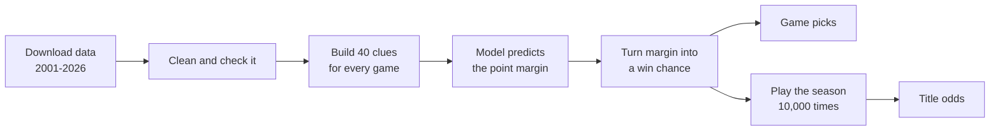

# 🏈 CFB Predictor

**An AI model that predicts college football games, and every team's chance to win the national title.**

For every game it answers three questions: *Who wins? By how much? How sure is the model?*
Then it plays out the rest of the season 10,000 times to estimate who will lift the trophy in January.

> **Short version:** I tested 16 different prediction methods on 12 full seasons they had never
> seen (2014-2025, 10,371 games). The winner picks the right team **75.7%** of the time, and when it
> says it is 80%+ sure, it is right **91.7%** of the time. Its percentages are honest: when it says
> "70%", that team really wins about 70% of the time.

**Live dashboard:** every 2026 pick, the season scorecard and the title odds, updated every Monday.
*(Link goes here once it is deployed on Streamlit Community Cloud. See [the dashboard](#the-dashboard-and-the-weekly-auto-update).)*

---

## Table of contents
1. [What this project does](#1-what-this-project-does)
2. [How it works, in plain words](#2-how-it-works-in-plain-words)
3. [The data](#3-the-data)
4. [The 40 clues the model uses](#4-the-40-clues-the-model-uses)
5. [The big test: 16 methods, one exam](#5-the-big-test-16-methods-one-exam)
6. [Results](#6-results)
7. [Why this algorithm won](#7-why-this-algorithm-won)
8. [Predicting the champion](#8-predicting-the-champion)
9. [How I keep the model honest](#9-how-i-keep-the-model-honest)
10. [Limits: what it can't do](#10-limits-what-it-cant-do)
11. [Run it yourself](#11-run-it-yourself)
12. [Project map](#12-project-map)
13. [Words you might not know](#13-words-you-might-not-know)
14. [Credits](#14-credits)

---

## 1. What this project does

| You ask | You get |
|---|---|
| "Who wins Michigan vs Michigan State?" | **Michigan, 87% chance, by about 18 points** |
| "Who wins the 2026 national title?" | A chance for every team: Georgia 24.5%, Ohio State 17.5%, Notre Dame 14.5%, ... |
| "How good is this model, really?" | A full report card against 12 past seasons and against Vegas |

Every week of the season it downloads the newest results, updates every team's ratings, and
makes fresh predictions.

## 2. How it works, in plain words

Think of a scout preparing for a game. They don't look at the final score (it hasn't happened
yet!). They look at how good each team has been, how talented the roster is, and how the season
is going. This model does the same thing, with numbers.



**Step by step:**
1. **Collect clues.** For each game, it builds 40 numbers that compare the two teams (for example,
   "home team's talent minus away team's talent").
2. **Predict the margin.** It multiplies each clue by a weight it learned from history and adds
   them up: "Texas by 14."
3. **Turn the margin into a chance.** The model's predictions usually miss by about 16 points, so a
   bell curve turns "by 14" into "81% to win". A 7-point favorite wins about 67% of the time.
4. **Repeat for the whole season.** For the title, it plays every remaining game 10,000 times,
   picks the 12-team playoff field the way the real committee would, and plays the bracket.

## 3. The data

All free and public, from the [SportsDataverse](https://github.com/sportsdataverse) project, which
republishes data from CollegeFootballData.com, ESPN and 247Sports.

- **362 files, 2001-2026**: every game, scores, rankings, recruiting, returning players,
  transfers, betting lines and more.
- Every file gets a **receipt** (`data/raw/_manifest.json`) with a fingerprint (sha256), so I can
  prove the data was never changed by accident.
- A **data audit** checks the data before any model trains. For example: all 22 real national
  champions from 2004 to 2025 must match my data. They do.

Problems I found and fixed (each became a rule in `vault/07 Lessons/`):
- The main schedule file was missing bowl and playoff games before 2023, so ESPN's schedules fill them in.
- About a third of 2006-2012 ESPN betting lines had the wrong sign (favorites "won" only 27%).
  I built my own consensus line from many sportsbooks instead.
- 33 games scored "0-0" were really cancelled games.

## 4. The 40 clues the model uses

Every clue is something you could know **the morning of the game**. Most are written as
"home team minus away team".

| Group | Clues | What they measure |
|---|---|---|
| **Team strength** (10) | Elo rating gap and Elo win chance; four "power ratings" (points, success rate, yards per play, postgame win expectancy) and the margin each one predicts | How good each team is right now, after adjusting for who they played. Ratings are recalculated every week |
| **Roster** (12) | Recruiting talent, share of 4- and 5-star players, returning offense and defense, transfer portal gains, last season's rating, power-conference team, big school vs small school | What each team has to work with |
| **This season's form** (12) | Games played, win %, season averages (scoring margin, success rate, big plays, havoc, turnovers, yards per play, win expectancy), last 3 games, rest days, AP rank | How the season is going. Early-season numbers are pulled toward average so one game can't fool the model |
| **Game setting** (6) | Home field, conference game, bowl, playoff, week of season, travel distance | Where and when the game is played |

**What I deliberately do NOT use:**
- **The final score or stats of the game being predicted.** That's the answer key. Using it is cheating (see section 9).
- **Vegas betting lines.** I only use them as a yardstick. The title forecast needs games weeks ahead, before lines exist, and I want my own model, not a copy of Vegas.
- **ESPN's FPI and "weekly" computer ratings.** Those files were rebuilt after each season, so early weeks secretly know later results.
- **Injuries and quarterback news.** No reliable free history exists. This is the biggest reason the model trails Vegas.

Full list with reasons: [`vault/03 Features/Feature Catalog.md`](vault/03%20Features/Feature%20Catalog.md)

## 5. The big test: 16 methods, one exam

Different sports reward different methods, so I didn't guess. I ran a fair contest.

**The rules (written down before seeing any results):**
- **Time travel, never shuffling.** To predict 2018, a method may only learn from 2005-2017.
  I repeat this for every season from 2014 to 2025: 12 seasons, 10,371 games. This copies real
  life: you only ever know the past.
- **Settings tuned on 2010-2013 only**, so the exam seasons stay untouched.
- **Main score: log loss.** It rewards honest confidence and punishes being confidently wrong.
  (Accuracy alone can't tell a lucky 51% guess from a solid 90% call.)
- **Statistical tests** (2,000 bootstrap re-runs + Holm correction) decide whether a gap is real or luck.
- **Tie rule:** if the top score isn't *significantly* better than a simpler method, the simpler one wins.

**The 16 contestants:**

| Type | Methods |
|---|---|
| Straight-line formulas | Margin ridge, logistic regression, logistic lasso |
| Tree methods | Margin LightGBM, LightGBM, XGBoost, histogram gradient boosting, random forest |
| Others | Neural network (MLP), support vector machine, k-nearest neighbors, Naive Bayes |
| Team effort | Ensemble (average of the top 3) |
| Simple baselines | "Home team always wins", my Elo rating, CFBD's public Elo |
| Yardstick (not a contestant) | The Vegas closing line |

## 6. Results

| Method | Log loss ↓ | Picks right | Catches home wins | Catches away wins | Right when 80%+ sure |
|---|---|---|---|---|---|
| Vegas closing line *(yardstick)* | 0.469 | 76.4% | | | 91.6% |
| Margin LightGBM *(top raw score)* | 0.4816 | 75.9% | 82.8% | 64.6% | 91.0% |
| **Margin ridge *(winner)*** | **0.4822** | **75.7%** | **83.2%** | **63.3%** | **91.7%** |
| Logistic regression | 0.4829 | 75.7% | 82.7% | 64.0% | 90.7% |
| Neural network | 0.4830 | 75.8% | 82.7% | 64.4% | 90.4% |
| Random forest | 0.4877 | 75.6% | 82.6% | 64.2% | 91.3% |
| My Elo | 0.5126 | 73.8% | 81.8% | 60.5% | 89.4% |
| Home team always | 0.6614 | 62.3% | 100% | 0% | n/a |
| *(coin flip)* | *0.693* | *50%* | | | |

**What the numbers mean:**
- **Picks right (accuracy) 75.7%:** about 3 out of 4 winners.
- **Recall:** of all the games the home team really won, the model called 83.2%. Away wins are harder
  (63.3%) because away teams are usually underdogs.
- **Confidence you can trust:** the "calibration error" is 1.3 percentage points. When the model
  says 70%, teams win about 70%.
- **Versus Vegas:** the model is 0.012 log loss behind (a real but small gap). Vegas knows about injuries and
  quarterback changes; my model doesn't.
- **Hardest games:** bowls and playoff games are close to coin flips for every method, because star players often skip bowls.

Full scoreboard: [`vault/04 Models/Algorithm Comparison.md`](vault/04%20Models/Algorithm%20Comparison.md) ·
visual report: `reports/model_report.html`

## 7. Why this algorithm won

**Six methods finished in a statistical tie** at the top. Margin LightGBM scored a hair better
(0.4816 vs 0.4822), but the test showed that gap is smaller than luck (p = 0.74). So the tie rule
picked the simplest method: **Margin ridge.**

Why a simple method is the right choice here:
1. **College football has a mostly straight-line pattern.** Better ratings and more talent mean
   bigger wins. Fancier methods mostly re-learn the same thing, then start memorizing noise.
2. **Predicting the margin beats predicting win/lose.** A 35-point win and a 1-point win are both
   "wins", but they say very different things about the teams. Learning from margins uses that.
3. **It's explainable.** Every pick can show exactly which clues pushed it ("Texas: +6 from
   talent, +4 from ratings, +3 home field"). That matters for people trusting the predictions.
4. **It's fast and stable.** It trains in seconds and gives the same answer on every computer.

What "ridge" means: a straight-line formula with a brake on each weight, so no single clue
can take over because of a few weird games.

What each clue group adds (removing groups one at a time):

| Clues used | Log loss | Picks right |
|---|---|---|
| Elo only | 0.5121 | 73.9% |
| + power ratings | 0.4958 | 74.7% |
| + roster | 0.4844 | 75.5% |
| + season form and AP poll | 0.4822 | 75.7% |

## 8. Predicting the champion

**How:** play every remaining game 10,000 times. In each simulated season:
1. Each team's strength is nudged up or down a little (no one is ever 100% sure how good a team is).
2. Conference title games are set from the simulated standings.
3. A **committee stand-in** ranks the teams. It learned from the real playoff rankings
   2014-2025 and matched 3.6 of the real top 4 and 11.1 of the real top 12 on average, in seasons it never saw.
4. The 12-team field follows the 2026 rules (Power 4 champions, the best Group of Six team,
   Notre Dame if top 12, at-large picks; the top 4 get byes) and the bracket is played out.

**Did it work in the past?** For every playoff from 2014 to 2025, the real champion got
an average **34%** chance from the model, vs 27% from Elo and 22% from pure chance. The
champion was the model's favorite in 7 of 12 years and in its top 2 in 10 of 12.

**2026 title odds** (games through Oct 10):

| Team | Title chance |
|---|---|
| Georgia | 24.5% |
| Ohio State | 17.5% |
| Notre Dame | 14.5% |
| Miami | 11.1% |
| Indiana | 7.8% |

No team is above 50%: with 12 teams, even the best one usually has to win 3 or 4 playoff games.
Read these as **chances, not promises.**

## 9. How I keep the model honest

- **No peeking (data leakage tests).** `tests/test_no_leakage.py` hides every result from a given
  week and checks that the clues for that week don't change. If a clue changed, it was secretly
  using the future.
- **Locked rules.** The test plan was written before any results (`vault/04 Models/Evaluation Protocol.md`).
- **Same answer everywhere.** Results were checked on Python 3.10 and 3.13, on Linux and Windows.
- **Automatic code checks.** Two Claude Code hooks review every code change and command
  output, block real errors, and turn every mistake into a written rule so it isn't repeated
  (`vault/07 Lessons/How the Hooks Work.md`).

## 10. Limits: what it can't do

- It doesn't know about **injuries, quarterback changes, suspensions or players skipping bowls.**
- It leans on **recruiting talent**, so teams that win above their recruiting (like Indiana) can be underrated.
- **Upsets are hard.** It calls about 15% of upsets, but chasing more upsets would make overall picks worse.
- **It's a forecast, not a guarantee.** A 90% pick still loses 1 time in 10.

## 11. Run it yourself

You need **Python 3.10 or newer**.

```bash
git clone <this repo>
cd cfb-predictor
python -m venv .venv
# Windows: .venv\Scripts\activate     macOS/Linux: source .venv/bin/activate
pip install -r requirements.txt
pip install -e .

python -m cfb.pipeline --download   # first time: downloads ~115 MB of data, then builds and tests everything (~10 min)
```

| Command | What it does |
|---|---|
| `python -m cfb.pipeline --weekly` | **Every Monday in season:** new results, new picks for the next week, new title odds (~2 min) |
| `python -m cfb.predict` | Picks for the next week, shown as "Away @ Home" |
| `python -m cfb.track` | Live 2026 scorecard: saves every pick before kickoff (current model + challenger), scores them after the games. Runs automatically in the weekly pipeline |
| `python -m cfb.predict --team Michigan` | One team's remaining games |
| `python -m cfb.pipeline` | Rebuild and re-test everything, including the 16-method contest (~7 min) |
| `python -m cfb.pipeline --list` | Show every step |
| `python -m pytest -q` | Run the tests |

The raw data isn't stored in this repository (it's large and anyone can re-download it), so run
`--download` once after cloning.

### The dashboard and the weekly auto-update

The dashboard (`app/streamlit_app.py`) shows every game of the season with the pick, the win
chance and the top reasons, plus the season record, an "are the percentages honest?" chart and
the title odds.

**It never runs the model.** It only reads small files in `reports/app/` that the weekly
pipeline writes. That makes it fast and free to host, and it keeps the record honest:

- **Finished games:** the pick saved before kickoff, with ✓ or ✗. These never change.
- **This week:** the latest pick. It can still move until kickoff, then it locks.
- **Later weeks:** an "early look". Each week of distance costs a little under 1 point of accuracy
  (75% for this week's games, about 71% five weeks out), and the dashboard says so.

Picks for weeks 1-6 of 2026 were re-created after the fact (tracking started in week 7), using only
information known before each game. The dashboard labels them that way.

**How it updates by itself:** a GitHub Actions job (`.github/workflows/weekly.yml`) runs every
Monday. It downloads the weekend's results, runs `python -m cfb.pipeline --weekly`, and commits
the new files. Streamlit Community Cloud sees the new commit and refreshes the dashboard.
Team ratings update every week; the formula itself is retrained once a year, after the season.

Run the dashboard on your own computer:

```bash
pip install -r app/requirements.txt
streamlit run app/streamlit_app.py
```

Put it online for free: sign in at [share.streamlit.io](https://share.streamlit.io) with GitHub →
**Create app** → pick this repository, branch `main`, main file `app/streamlit_app.py` → **Deploy**.

## 12. Project map

```
src/cfb/
  data/       download (with receipts), clean, audit
  features/   Elo, power ratings, the 40 clues
  eval/       the walk-forward contest, scores, significance tests
  models/     all 16 methods, the final model, the model card
  sim/        matchups, playoff bracket, committee stand-in, season simulator
  report/     HTML report, Obsidian notes, dashboard data (app_data.py)
  pipeline.py one command that runs everything in order
app/          the public Streamlit dashboard
.github/      the Monday auto-update job
tests/        leakage, betting-line and simulator tests
models/       final_model.joblib + model_card.json
reports/      model_report.html, contest results, title odds, weekly picks
vault/        Obsidian notes: decisions, experiments, lessons, glossary
.claude/      Claude Code hooks
```

## 13. Words you might not know

| Word | Meaning |
|---|---|
| **Feature / clue** | One number the model looks at, like "talent difference" |
| **Training** | Letting the model learn weights from past games |
| **Walk-forward test** | Testing season by season, only ever learning from the past |
| **Data leakage** | When a model accidentally sees the answer. Makes test scores look great and real predictions bad |
| **Log loss** | The main score. Punishes being confidently wrong. Lower is better; a coin flip is 0.693 |
| **Accuracy** | Share of games where the model's pick won |
| **Recall** | Of the games a side really won, the share the model called |
| **Calibration** | Whether the percentages are honest (70% means 70%) |
| **Elo** | A chess-style rating: beat a strong team, gain a lot |
| **Opponent-adjusted** | Beating a top-10 team by 7 counts more than beating a weak team by 30 |
| **Ridge regression** | A straight-line formula with brakes on its weights |
| **Bootstrap** | Re-scoring thousands of reshuffled samples to see how much a score could move by luck |
| **Monte Carlo** | Playing something thousands of times with weighted coin flips and counting outcomes |

## 14. Credits

- Data: [SportsDataverse](https://github.com/sportsdataverse) (`cfbfastR-data`, `sportsdataverse-data`),
  originally from CollegeFootballData.com, ESPN and 247Sports. Please respect their terms.
- Built by Prasidh Shetty with Claude.
- Not betting advice. For learning and fun.
